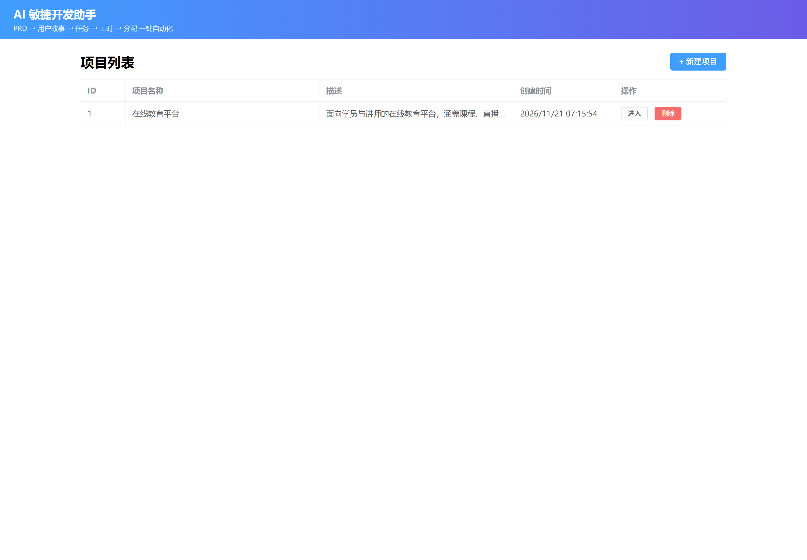
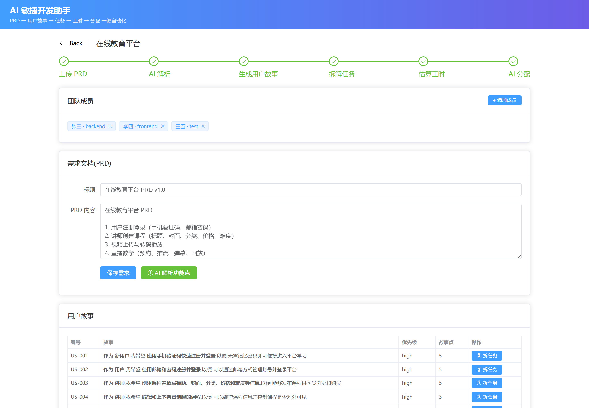
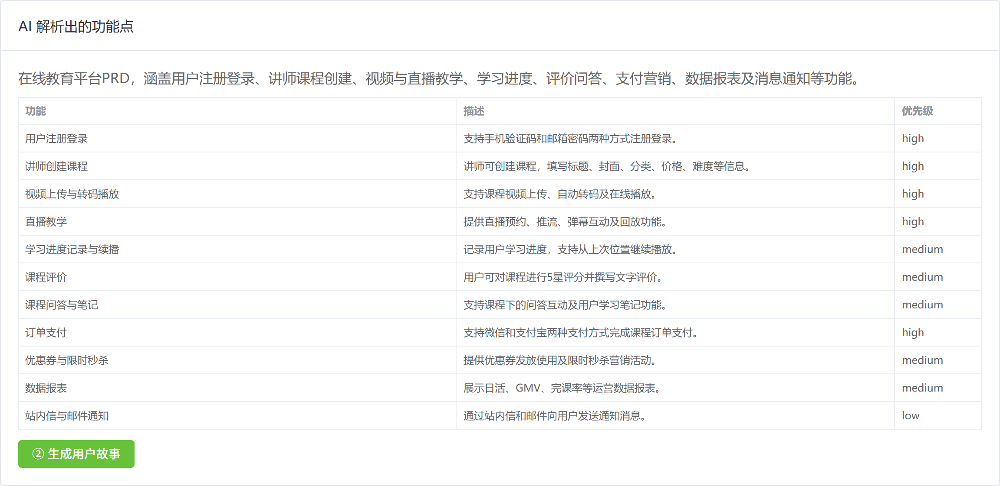
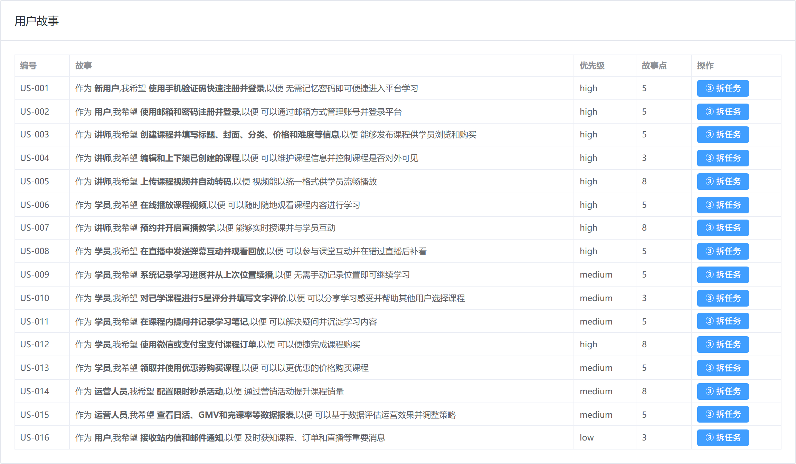
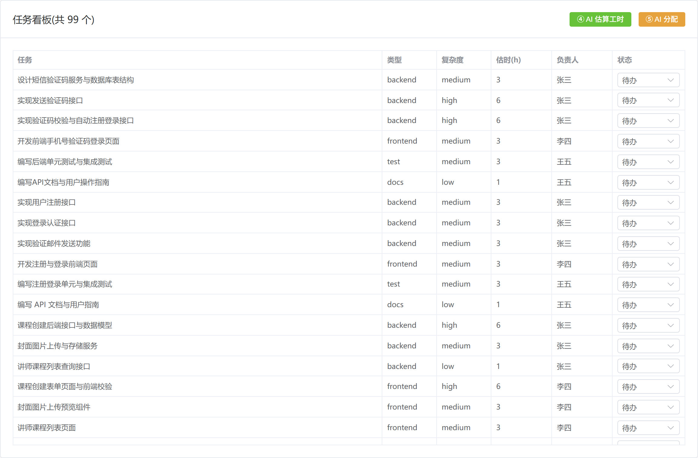
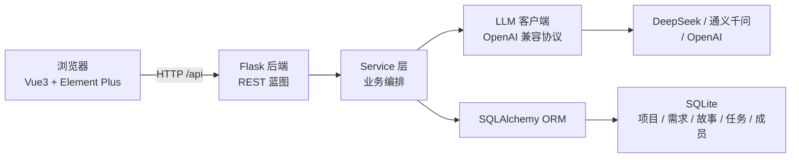

# AI 敏捷开发助手(AI Agile Assistant)

> 基于 LLM 的 **PRD → 用户故事 → 任务 → 工时 → 分配** 一键自动化平台
> 毕业实习项目 · 主题:如何用 AI 辅助团队软件开发

## 项目简介

输入需求文档(PRD),系统自动完成敏捷开发前期的人力消耗大、主观性强的环节:
1. **AI 解析功能点** — 从 PRD 抽取功能清单
2. **AI 生成用户故事** — 按 INVEST 原则拆分
3. **AI 拆解开发任务** — 故事 → 前后端/测试/文档任务
4. **AI 估算工时** — 基于任务复杂度
5. **AI 分配任务** — 按成员技能与负载

## 界面预览

**项目列表**



**项目详情:步骤引导 / 团队成员 / PRD 录入**



**① AI 解析功能点**(从 PRD 自动抽取功能清单与优先级)



**② 用户故事**(按 INVEST 原则拆分,含角色、目标、优先级、故事点)



**③④⑤ 任务看板**(任务拆解 + 工时估算 + 按技能自动分配给成员)



> 上图为真实运行截图:一份包含 11 条需求的 PRD 经 AI 处理,产出 11 个功能点、16 个用户故事、99 个任务,
> 全部完成工时估算并按"后端→张三 / 前端→李四 / 测试→王五"的规则自动分配。

## 系统架构



**数据流**:PRD 文本 → Service 层拼接 Prompt → 调用 LLM 返回 JSON → 解析校验 → 写入数据库 → 前端表格/看板展示。

## 目录结构

```
project/
├── backend/              # Flask 后端
│   ├── app/
│   │   ├── __init__.py   # 应用工厂
│   │   ├── config.py     # 配置(从 .env 读取)
│   │   ├── extensions.py # db / cors
│   │   ├── models/       # SQLAlchemy 模型
│   │   ├── llm/          # LLM 客户端 + Prompt 模板
│   │   ├── services/     # 业务逻辑
│   │   └── api/          # Flask 蓝图(REST 接口)
│   ├── tests/            # pytest 测试
│   ├── requirements.txt
│   ├── Dockerfile
│   └── run.py
├── frontend/             # Vue3 + Element Plus 前端
│   ├── src/
│   │   ├── api/          # axios 封装
│   │   └── views/        # 首页 / 项目详情
│   ├── package.json
│   └── Dockerfile
├── docker-compose.yml
└── README.md
```

## 快速开始

### 后端

```bash
cd backend
python -m venv .venv
.venv\Scripts\activate              # Windows
# source .venv/bin/activate         # Linux/Mac
pip install -r requirements.txt

# 配置 LLM(复制 .env.example 为 .env,填入 API Key)
copy .env.example .env              # Windows
# cp .env.example .env              # Linux/Mac

python run.py
# 访问 http://localhost:5000/api/health
```

### 前端

```bash
cd frontend
npm install
npm run dev
# 访问 http://localhost:5173
```

### Docker 一键启动

```bash
# 在项目根目录创建 .env
echo LLM_API_KEY=your-key-here > .env
docker compose up --build
```

## 使用流程

启动前后端后,浏览器打开 `http://localhost:5173`,按以下步骤操作:

| 步骤 | 操作 | 结果 |
|---|---|---|
| 1 | 首页点「+ 新建项目」 | 创建项目,进入项目详情 |
| 2 | 「+ 添加成员」录入姓名、角色、技能、周工时 | 成员列表出现标签 |
| 3 | 粘贴 PRD 文本 → 「保存需求」 | 需求入库 |
| 4 | 点「① AI 解析功能点」 | LLM 抽取功能清单 + 优先级 |
| 5 | 点「② 生成用户故事」 | 按 INVEST 原则产出用户故事 |
| 6 | 对每个故事点「③ 拆任务」 | 生成前后端/测试/文档任务 |
| 7 | 点「④ AI 估算工时」 | 按复杂度给出工时 |
| 8 | 点「⑤ AI 分配」 | 依据成员技能与负载自动派工 |

> 提示:项目内需要先添加成员,否则 ⑤ AI 分配 无法执行。

## LLM 配置

支持任何 OpenAI 兼容协议:

| 提供商 | LLM_BASE_URL | LLM_MODEL |
|---|---|---|
| DeepSeek | https://api.deepseek.com/v1 | deepseek-chat |
| 通义千问 | https://dashscope.aliyuncs.com/compatible-mode/v1 | qwen-plus |
| OpenAI | https://api.openai.com/v1 | gpt-4o-mini |

在 `backend/.env` 中配置:
```
LLM_API_KEY=sk-xxx
LLM_BASE_URL=https://api.deepseek.com/v1
LLM_MODEL=deepseek-chat
```

## API 概览

| 方法 | 路径 | 说明 |
|---|---|---|
| POST | /api/projects | 创建项目 |
| GET | /api/projects | 项目列表 |
| POST | /api/requirements | 保存 PRD |
| POST | /api/requirements/{id}/parse | ① AI 解析功能点 |
| POST | /api/stories/generate | ② AI 生成用户故事 |
| POST | /api/tasks/decompose | ③ AI 拆解任务 |
| POST | /api/tasks/estimate | ④ AI 估算工时 |
| POST | /api/tasks/assign | ⑤ AI 分配任务 |
| POST | /api/members | 添加成员 |

## 测试

```bash
cd backend
.venv\Scripts\python.exe -m pytest tests/ -v
```

## 常见问题 FAQ

**Q1: 后端启动时报端口被占用（`Address already in use` / `10048`）？**

Flask 默认使用 5000 端口。先找出占用进程再结束它：

```powershell
netstat -ano | findstr :5000     # 记下最后一列 PID
taskkill /PID <PID> /F            # 结束进程
```

或者修改 `backend/.env` 中的 `FLASK_PORT=5001` 换端口，同时同步修改 `frontend/vite.config.js` 里代理的目标端口。

**Q2: `npm install` 很慢或失败？**

默认源访问慢时可切换国内镜像：

```powershell
npm config set registry https://registry.npmmirror.com
npm install
```

如果提示 esbuild 等包的 install scripts 被拦截（npm 新版安全策略），执行：

```powershell
npm approve-scripts esbuild
npm rebuild esbuild
```

**Q3: `pip install` 很慢？**

使用清华镜像安装：

```powershell
pip install -r requirements.txt -i https://pypi.tuna.tsinghua.edu.cn/simple
```

**Q4: LLM 相关接口报错（解析/生成/估算/分配失败）？**

按顺序检查：

1. 后端是否已启动（`http://localhost:5000/api/health` 能访问）
2. `backend/.env` 中 `LLM_API_KEY` 是否正确、DeepSeek 账户是否有余额
3. 查看后端终端的具体报错信息——`Authentication Error` 是 Key 无效，`Insufficient Balance` 是欠费，超时多为网络问题

**Q5: PowerShell 激活虚拟环境报「禁止运行脚本」？**

执行一次（当前用户生效，之后新开的终端不需要再执行）：

```powershell
Set-ExecutionPolicy -Scope CurrentUser RemoteSigned
```

然后重新执行 `.venv\Scripts\Activate.ps1`。

**Q6: `git push` 连不上 GitHub？**

多为网络问题。可尝试：切换网络（如手机热点）、重试几次，或临时使用镜像地址推送。克隆慢可用镜像加速，例如 `git clone https://gh-proxy.com/https://github.com/num6er/ai-agile-assistant.git`（镜像仅用于拉取，推送需指回原地址）。

## AI 辅助开发说明(答辩要点)

本项目严格遵循实习要求:

1. **开发工具采用 AI 辅助**
   - 全程使用 Trae / Cursor / Copilot 编码
   - 报告附 AI 工具使用记录

2. **用 AI 生成代码**
   - 后端 Flask 路由、SQLAlchemy 模型、Prompt 模板大部分由 AI 生成
   - 前端 Vue 组件、表单、看板由 AI 生成
   - 量化:AI 生成代码占比 60%+

3. **用 AI 完成测试**
   - pytest 测试用例由 AI 生成
   - 覆盖健康检查、项目 CRUD、需求、成员、任务流转等

## 技术栈

- 后端:Python 3.11+ / Flask 3.0 / SQLAlchemy 2.0 / openai SDK
- 前端:Vue 3 / Vite 5 / Element Plus / axios
- 数据:SQLite(开发) / Docker(部署)
- LLM:DeepSeek / 通义千问 / OpenAI(可切换)
